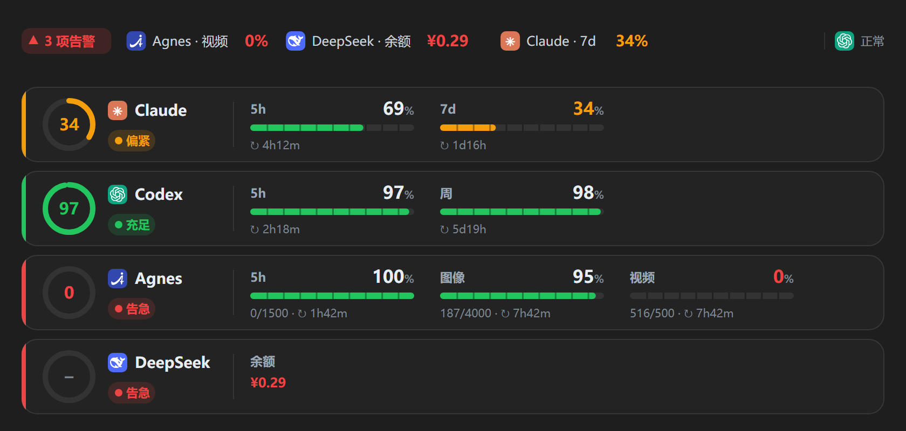

# usage-dash

[](https://github.com/chinbor/usage-dash/actions/workflows/ci.yml)
[](LICENSE)

在 Claude Code 输入框上方显示一条 AI 订阅额度仪表盘：Claude、Codex（ChatGPT）、Agnes、DeepSeek，或任何有 JSON 接口的平台。



- **概览**（默认折叠）：一行，只说需要注意的：「▲ 2 项告警」、每条告警的平台 · 窗口 · 剩余（百分比或余额），正常的平台叠成小图标。告警多时显示 `+N`。
- **详情**（点「详情 ▾」）：每个平台一行，环形仪表显示最紧的窗口，每个时间窗口一格（剩余百分比、进度条、次数、重置倒计时）。绿色充足、黄色偏紧、红色告急。平台多时详情分页显示，用「收起」左边的「‹ 1/2 ›」翻页；横条不会超出位置、不和对话滚动抢滚轮，告警栏始终在顶部。
- 额度或余额低于阈值时弹一次提示；`display: status` 时状态栏只显示告警。
- 桌面版（Code 标签页）用 SVG 绘制，带各平台图标；终端里是彩色字符进度条。

## 安装

需要 Claude Code 2.1.275 或更高版本。在终端会话里：

```
/plugin install usage-dash --marketplace chinbor/usage-dash
```

或在 shell 里：

```bash
claude plugin install usage-dash --marketplace chinbor/usage-dash
```

桌面版：点输入框旁的 + → Plugins → Add marketplace，填 `chinbor/usage-dash`，再 Add plugin。

卸载：`claude plugin uninstall usage-dash`。

## 增删订阅

订阅会变，配置也跟着变。全部在 `~/.claude/usage-dash.json`（首次运行自动生成，默认只有 Claude 和 Codex），也可以用命令改：

| 命令 | 作用 |
| --- | --- |
| `/usage-dash` | 刷新并列出所有数据源（含未配置的） |
| `/usage-dash types` | 能加哪些类型、各自需要什么 |
| `/usage-dash add <类型> [id]` | 按模板添加一个数据源 |
| `/usage-dash disable <id>` / `enable <id>` | 暂停 / 恢复（退订但可能回来） |
| `/usage-dash remove <id>` | 删除 |
| `/usage-dash path` | 配置文件位置 |

没配好凭据的数据源（比如还没设环境变量）默认不在横条里出现，`/usage-dash` 会列出它缺什么。设 `"hideUnavailable": false` 可让它们也显示。

## 内置类型

| 类型 | 显示 | 需要 |
| --- | --- | --- |
| `claude` | 5 小时 / 7 天窗口；新会话先显示上次的读数（标注多久前），首次回复后更新 | Claude 订阅登录 |
| `codex` | 5 小时 / 每周窗口，实时（`codex app-server`），失败时读本地会话记录 | PATH 上有 `node` 和 `codex`，已登录 |
| `agnes-plan` | Agnes 套餐：文本 5 小时 / 每周、图像 / 视频每日 | `AGNES_EMAIL` + `AGNES_PASSWORD`（自动登录，token 只在内存），或 `AGNES_PLATFORM_TOKEN` |
| `deepseek` | 账户余额；低于 `warnBalance`（默认 5，设 0 关闭）告急，低于两倍偏紧 | `DEEPSEEK_API_KEY` |
| `openai-billing` | new-api / one-api 中转站额度和已用 | `baseUrl` + `keyEnv` |
| `http-json` | 任意 JSON 接口，配置里写字段路径 | `url`，按需 `auth.env` |

### 不写代码接入新平台：`http-json`

```json
{
  "id": "minimax",
  "type": "http-json",
  "label": "MiniMax",
  "icon": "M",
  "color": "#f23f5d",
  "url": "https://api.example.com/v1/usage",
  "auth": { "env": "MINIMAX_API_KEY" },
  "root": "data",
  "windows": [
    { "name": "5h", "used": "window.used", "limit": "window.limit", "resetInSeconds": "window.reset_in" }
  ],
  "values": [{ "name": "余额", "path": "balance", "unit": "元" }]
}
```

- 路径用点号（`a.b.0.c`），都在 `root` 之下。
- 一个窗口给 `used` + `limit`、`usedPercent` 或 `remainingPercent` 之一即可；重置时间给 `resetInSeconds`，或 `resetsAt`（秒、毫秒或 ISO 时间）。
- `auth` 默认 `Authorization: Bearer <key>`，可改 `header` 和 `prefix`；也可以加 `method`、`headers`、`body`。

要写代码的适配器（需要登录、多步请求）见 [docs/providers.md](docs/providers.md)。

## 其他配置

```json
{
  "$schema": "https://raw.githubusercontent.com/chinbor/usage-dash/main/schema/config.schema.json",
  "refreshSeconds": 300,
  "warnPercent": 20,
  "hideUnavailable": true,
  "sources": []
}
```

- `warnPercent`：剩余低于它为告急（红），低于两倍为偏紧（黄）；每个数据源可单独设。
- 每个数据源可设 `label`、`icon`（一两个字符或 emoji）、`color`。
- 插件选项（`/plugin` 里设置）：`display` = `band`（默认，输入框上方，与别的横条叠放）/ `status`（状态栏只显示告警）/ `off`；`configPath` 改配置文件位置。

## 安全

- 配置文件只写**环境变量名**，从不写 key、token 或密码。
- 环境变量按名读取：macOS / Linux 用 `printenv`；Windows 先读进程环境，再读注册表里的用户变量（所以设置后不用重启）。
- Agnes 的登录 token 只保存在内存里，不写盘。

## English

A usage band above the Claude Code prompt for your AI subscriptions. Collapsed it shows only alerts; expanded, one row per source with a gauge and a bar per quota window. Sources are configured in `~/.claude/usage-dash.json` or with `/usage-dash add|remove|enable|disable|types`; `http-json` maps any JSON endpoint without code. Keys are read from environment variables by name and never written to disk.

## 开发

```bash
claude plugin validate .
claude plugin test .
```

推送和 PR 会在 GitHub Actions 里跑同样的校验和测试。改动记录见 [CHANGELOG.md](CHANGELOG.md)。

## 致谢

DeepSeek 鲸鱼、OpenAI（Codex）和 Agnes AI 图标的路径数据来自 [lobe-icons](https://github.com/lobehub/lobe-icons)（MIT），商标归各自所有者。

## 许可

[MIT](LICENSE)
